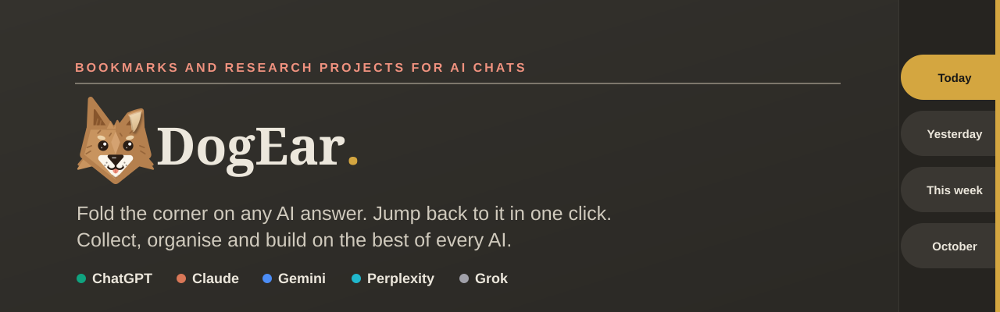
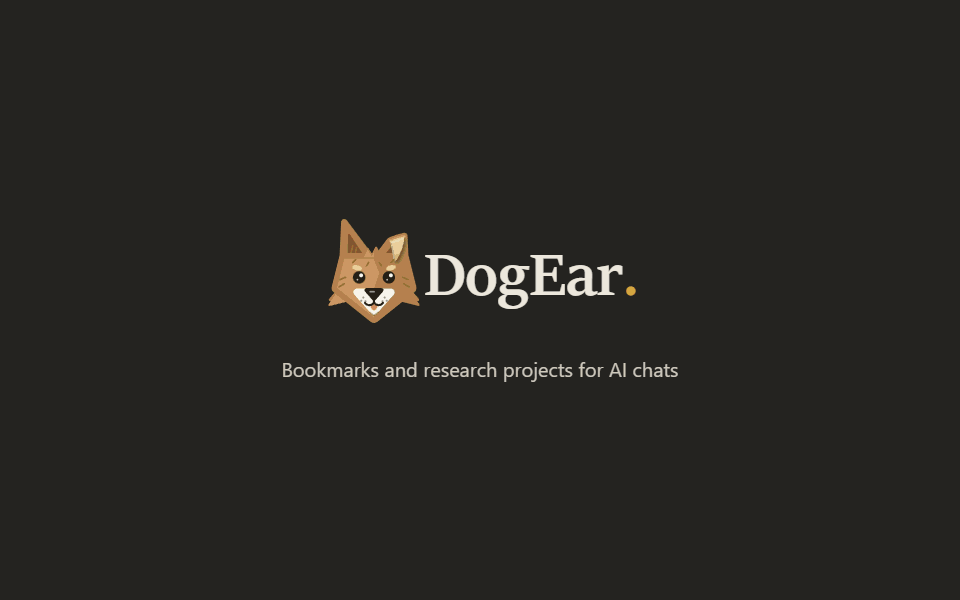
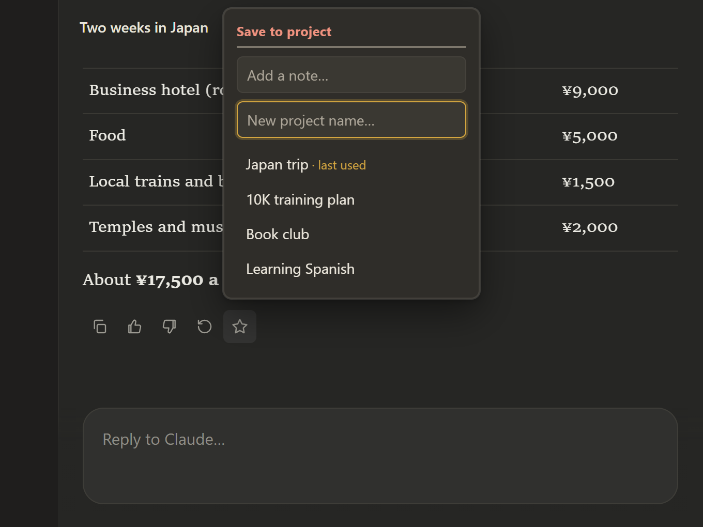
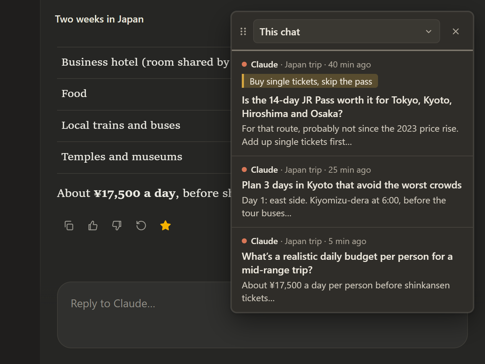
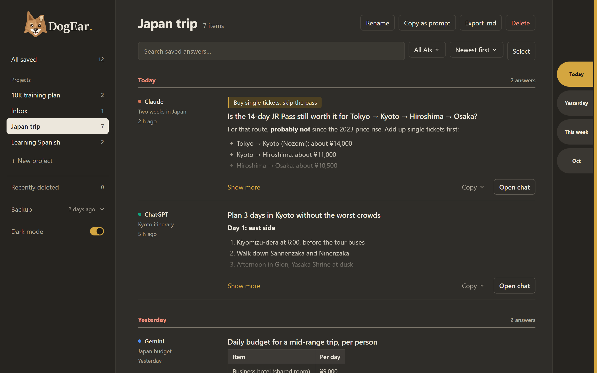
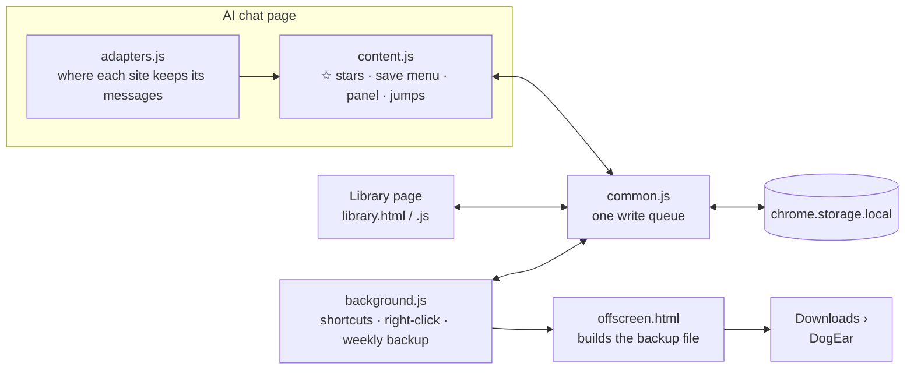

<p align="center">
  
</p>

<p align="center">
  <a href="https://chromewebstore.google.com/detail/hmnaddjjpiemgmdjgmcdhgaggiiaibnb"></a>
  
  
  
  
</p>

<p align="center">
  
  <br>
  <sub>One research project, each AI for what it does best: Claude to explain, ChatGPT for the maths, Perplexity for sources, all in one Library.</sub>
  <br>
  <sub><a href="https://www.youtube.com/watch?v=xKkEEgoeyUw">▶ Watch it with sound on YouTube</a></sub>
</p>

---

AI chats are where a lot of real work happens now, but they're terrible at keeping it. The one
answer you need is message 78 of 400, the chat search can't find it, and the research for one
topic is spread over four different AIs.

**DogEar** adds a ☆ to every AI answer, like folding the corner of a page. Star the ones that matter, then jump straight
back to them later, even in a 400-message chat or a chat you closed last week. Starred answers
go into your own **projects**, so one research topic can collect the best answers from ChatGPT,
Claude, Gemini, Perplexity and Grok side by side.

<!-- Screenshots: docs/screenshots/*.png, 1280×800 at 2× (made from demo data) -->
<table>
  <tr>
    <td width="50%"></td>
    <td width="50%"></td>
  </tr>
  <tr>
    <td align="center"><sub><b>☆ on every answer</b>: save it to a project, add a note</sub></td>
    <td align="center"><sub><b>Alt+B panel</b>: every star in this chat, one click away</sub></td>
  </tr>
  <tr>
    <td colspan="2"></td>
  </tr>
  <tr>
    <td colspan="2" align="center"><sub><b>The Library</b>: all your projects, searchable, with dictionary-style index tabs</sub></td>
  </tr>
</table>

## Features

### In the chat

- **☆ on every answer** that looks and behaves like the site's own buttons: same size, colour,
  hover and tooltip on each of the five AIs.
- **Save to a project** in two clicks, or type a new project name. Click the ★ again to move it,
  add a note or remove it.
- **Jump back to any star.** The chat scrolls to the message and lights up the question you asked.
  This works in very long chats (it loads older messages for you) and across chats (it opens the
  right chat first). Answers from another AI open in a new tab.
- **Notes.** Write a short note on any answer, like *“the formula I need for Q3”*. It shows
  under the answer in the chat, in the panel and in the Library.
- **Keyboard first:** `Alt+B` opens the panel, `Alt+↑` / `Alt+↓` hop between the stars in the
  current chat.

### In the Library

- **Projects** for each research topic, with answers from any mix of AIs.
- **Find anything fast:** full-text search with highlighted matches (`/` to start typing), a filter
  by AI, and sorting by date, by AI or by chat.
- **Dictionary-style index tabs** on the page edge jump between *Today*, *Yesterday*, *This week*
  and earlier months.
- **Answers keep their formatting:** code blocks, lists, tables, links and **maths**. Formulas are
  saved as readable text, e.g. `x = (−b ± √(b^2 − 4ac))/(2a)`.
- **Copy as prompt** turns a whole project into one message you can paste into any AI to
  continue the research.
- **Copy** an answer as plain text or Markdown, **export** a project as a `.md` file, move or delete
  several answers at once.
- **Nothing is lost by accident:** deleting shows an *Undo* bar, and deleted items stay in
  *Recently deleted* for 30 days.
- **Light and dark mode**, shared by the Library, the save menu and the panel.

### Your data

- **Everything stays in your browser.** No account, no server, no tracking, no analytics.
- **The answer text itself is saved**, not just a link, so your bookmarks survive even if the
  chat is deleted.
- **Automatic weekly backup** to `Downloads › DogEar`. The newest 5 are kept, and
  **Restore backup…** merges one back without creating duplicates.
- **Right-click → “Save selection”** on any web page saves the text into your *Inbox*.

## Shortcuts

| Shortcut | What it does |
| --- | --- |
| `Alt+B` | Open or close the panel of starred answers |
| `Alt+↓` / `Alt+↑` | Jump to the next / previous starred answer in this chat |
| `/` | Search the Library |
| `Esc` | Close a menu or cancel a search for a message |

You can change these at `chrome://extensions/shortcuts`.

## Install

**[Add DogEar to Chrome](https://chromewebstore.google.com/detail/hmnaddjjpiemgmdjgmcdhgaggiiaibnb)**
from the Chrome Web Store. It's free and updates itself. It also works in Edge, Brave and other
Chromium browsers.

Then open a chat on [ChatGPT](https://chatgpt.com), [Claude](https://claude.ai),
[Gemini](https://gemini.google.com), [Perplexity](https://www.perplexity.ai) or
[Grok](https://grok.com) and look for the ☆ next to the buttons under an answer.

**From source** (to try changes or contribute):

1. Download this repo (**Code → Download ZIP**) and unzip it, or `git clone` it.
2. Open `chrome://extensions` in Chrome.
3. Turn on **Developer mode** (top right).
4. Click **Load unpacked** and choose the folder.

## How it works



Plain JavaScript and CSS, Manifest V3, **no frameworks, no libraries and no build step**. The
code is split so that **all site-specific knowledge lives in one file**: each AI is a small
*adapter* describing where its answers, questions and buttons are. Everything else (stars,
menus, the panel, jumping, saving) works the same on every site.

### Problems worth solving

These AI sites are large, constantly changing single-page apps, and most of the work was in the
details:

- **Messages that aren't on the page.** Claude only keeps messages near the screen in the page,
  and most sites load older messages only as you scroll up. A jump finds a message by its id
  first, then by a fingerprint of its text. It goes straight to where the answer should be,
  measured as *distance from the end of the chat*, because that stays true while older messages
  load above. If the answer isn't there, it sweeps the chat. A quiet overlay hides the page
  jumping around while it searches.
- **Sites that pull you back down.** Chat pages stick to the bottom while they load, so the jump
  tells the site the user scrolled away, the same way a real mouse wheel does.
- **Each site's quirks, measured, not guessed.** Long jumps were tuned from about 70 logged test
  jumps across all five sites. That uncovered, for example, that Claude only loads older messages
  while the chat is scrolling, and that ChatGPT reuses the old chat's message boxes when you
  switch chats.
- **Looking built-in.** The ☆ copies the size, colour, hover and tooltip of each site's own
  buttons, measured from the live page. Animations use the Web Animations API, because some
  sites switch off CSS animations.
- **Menus that stay visible.** Before showing a menu, the extension checks what is really drawn
  on top of it, and moves it out of the site's layers if something would cover it.
- **Maths that survives copying.** Formulas drawn with KaTeX are read from their MathML and
  written out as readable text: fractions, powers, roots, matrices, `50°`, `Å`.
- **Writes that never collide.** Every change goes through one queue, so quick saves from several
  tabs can't overwrite each other.

### Project structure

| File | What it does |
| --- | --- |
| `manifest.json` | Permissions, the five sites, keyboard shortcuts |
| `adapters.js` | The only site-specific code: where each AI keeps its messages and buttons |
| `content.js` | Stars, save menu, panel, notes and jump-to-message |
| `content.css` | Everything shown inside the chat sites (all classes start with `acb-`) |
| `common.js` | All storage reads and writes, the write queue, backups, Markdown export |
| `background.js` | Toolbar icon, right-click save, shortcuts, weekly backup |
| `offscreen.html/.js` | Turns a backup into a file to download |
| `library.html/.js/.css` | The Library page |

### Adding another AI

A new site is mostly one adapter in `adapters.js`:

```js
{
  name: 'Example AI',
  hosts: ['chat.example.com'],
  convPattern: /\/c\/([\w-]+)/,                    // the chat's id in the URL
  userSelectors: ['[data-role="user"]'],            // the questions
  aiSelectors: ['[data-role="assistant"]'],         // the answers (☆ goes on these)
  actionsSelectors: ['[data-testid="message-actions"]'], // the site's button row
  msgId: el => el.dataset.messageId                 // a stable id per message, if the site has one
}
```

Optional settings let the ☆ copy a specific button's look, place it before a given button, or
wait until an answer has finished writing.

## Known limits

- When a site redesigns its page, the extension can stop finding answers there until its adapter
  is updated. It fails quietly and never breaks the site.
- Very old answers in huge chats can take several seconds to reach, mostly while the site
  itself loads older messages.

## Roadmap

- [x] Stars, projects, panel and jumping on five AIs
- [x] Library with search, sorting, index tabs and dark mode
- [x] Notes, *Copy as prompt*, automatic backup, `Alt+↑` / `Alt+↓`
- [x] Works when a site is shown in another language
- [x] [Chrome Web Store](https://chromewebstore.google.com/detail/hmnaddjjpiemgmdjgmcdhgaggiiaibnb) release
- [ ] Maybe: save part of an answer, compare AIs side by side, tags

## Privacy

DogEar has no server and sends nothing anywhere: see the [privacy policy](PRIVACY.md).

## License

[MIT](LICENSE) © Rishit Sharma
